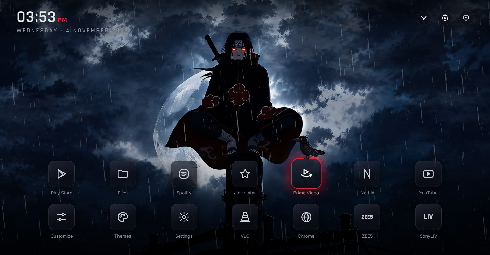
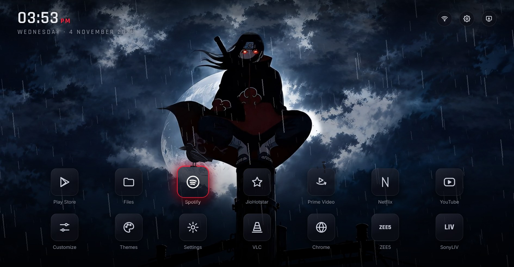
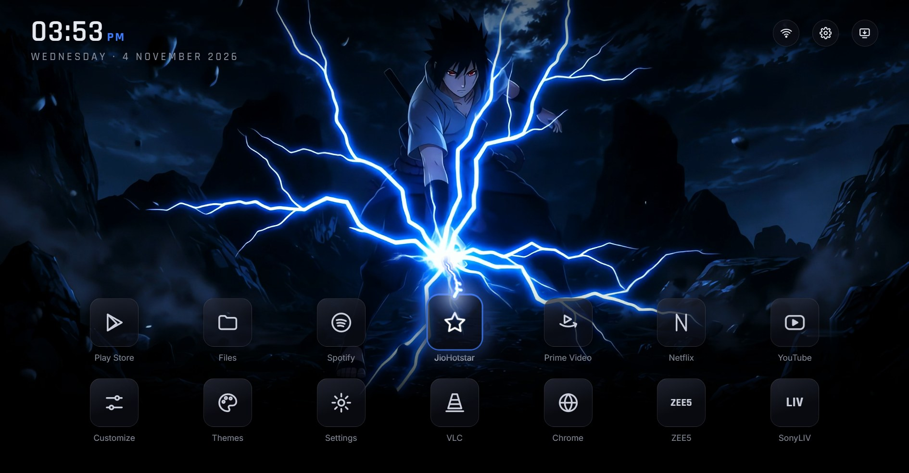
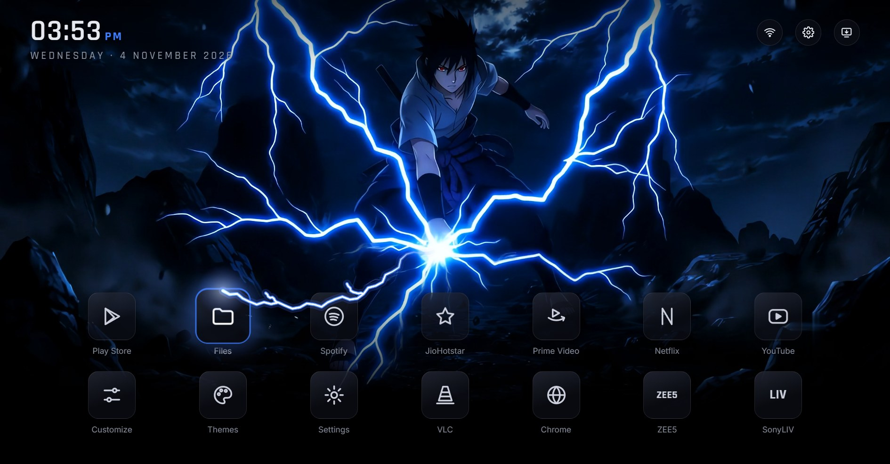
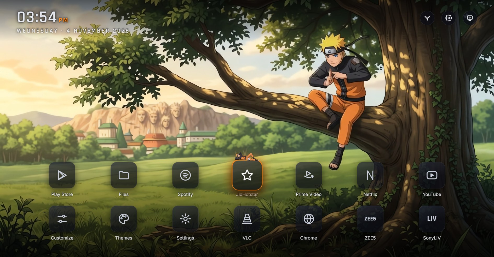
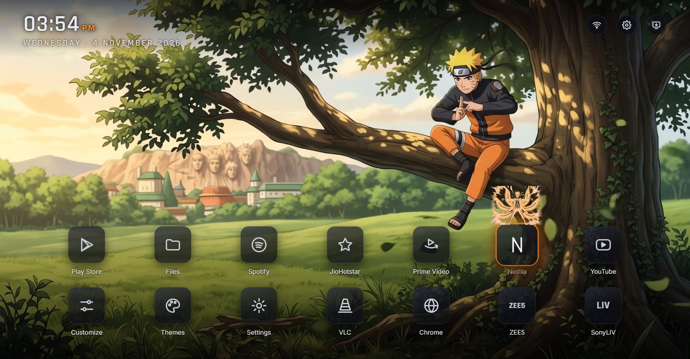
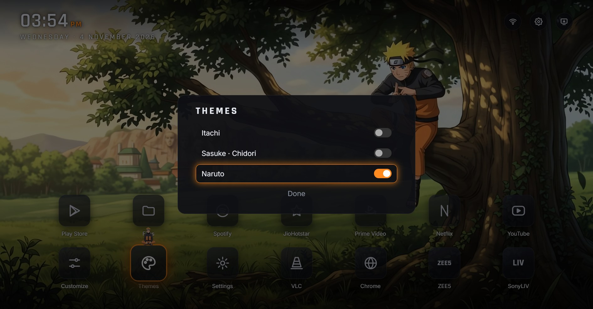
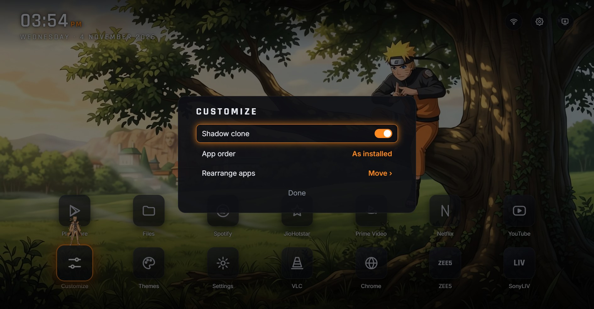
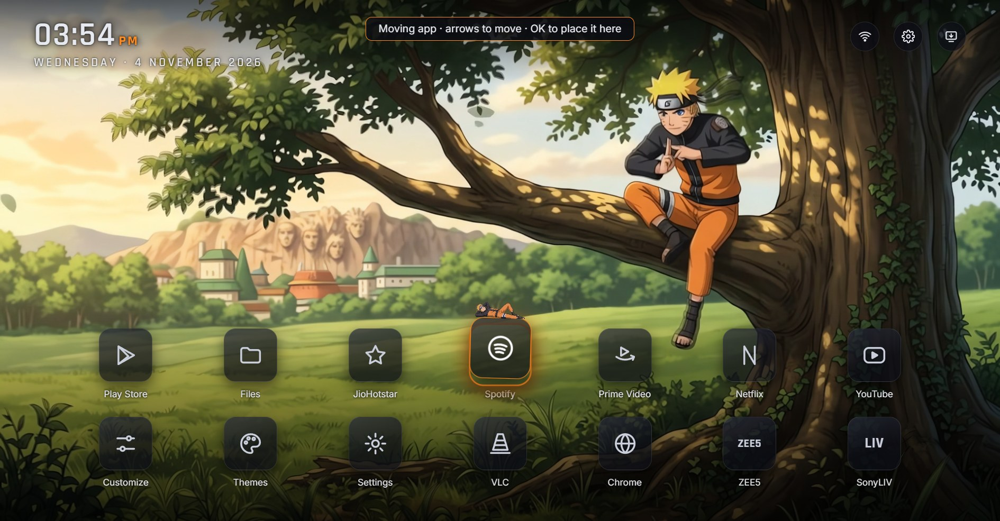
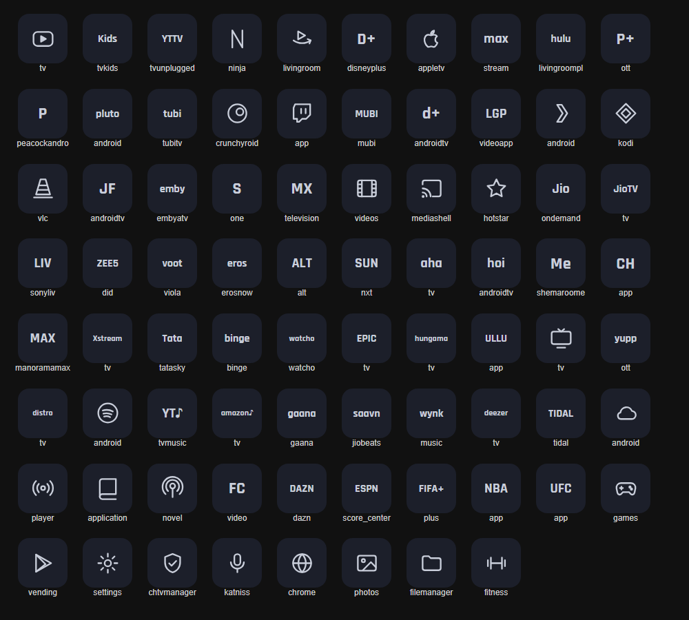

# Anime TV Launcher

A themed Android TV home screen with animated anime backgrounds. The UI is a web page (HTML/JS) running inside a WebView, with the background video played by Android's own hardware player so it stays smooth on low-power TVs.

Themes: **Itachi** (rainy night, crow, lightning flashes), **Sasuke · Chidori** (lightning beam from the hand to the selected app), **Naruto** (shadow clones that stand on the selected app and perform moves).

## Screenshots

Captured at 1080p with the real effects running (the web UI on a PC, with demo apps standing in for a TV's real ones).

### Itachi
Rain, drifting clouds, lightning flashes and a crow that flies to the selected app.

| | |
|---|---|
|  |  |

### Sasuke · Chidori
A single lightning beam runs from the Chidori in his hand to the selected app and slides along as you move.

| | |
|---|---|
|  |  |

### Naruto
A shadow clone is summoned on the selected app in a puff of smoke, stands breathing, then performs a move (ten different clones).

| | |
|---|---|
|  |  |

### Switching themes, customizing, moving apps

| Themes | Customize | Move mode |
|---|---|---|
|  |  |  |

### App icons
Every app gets a matching line icon or wordmark.



## Install (TV or any Android 8+ device)

1. Download `app-debug.apk` from the [latest release](../../releases/latest).
2. Put it on the TV (USB stick, or `adb install app-debug.apk`).
3. Open it once, then choose it as the Home app when Android asks. Over adb: `adb shell cmd package set-home-activity com.vivek.tvlauncher/.MainActivity`.

The APK is signed with the standard Android debug key, so Android treats it as a sideloaded app. It asks for location only so it can show your Wi-Fi network name.

## Features

- Two-row app grid that scrolls; apps get matching line icons (about 125 common TV apps are mapped; others get a name-based guess).
- **Themes** and **Customize** tiles: switch theme, toggle effects, choose the app order (A–Z, Z–A, most used, your own).
- Hold **OK** for 2 seconds on an app to pick it up, move it with the arrows, press OK to drop it.
- Round Wi-Fi, Settings and Inputs buttons (Inputs opens the TV's own input list).

## Build

Needs JDK 17 and the Android SDK (platform 35).

```bash
# once: tell Gradle where the SDK is
echo "sdk.dir=/path/to/android-sdk" > local.properties
gradle wrapper --gradle-version 8.9      # creates ./gradlew
./gradlew assembleDebug                  # app/build/outputs/apk/debug/app-debug.apk
```

## Try the UI on a PC

```bash
python -m http.server 8765 --directory web
```

Open http://localhost:8765, press F11. Arrow keys and Enter work like a remote; hold Enter for 2 seconds to move an app. Demo apps stand in for the TV's real ones.

## Project layout

| Path | What it is |
|---|---|
| `app/` | Android app: `MainActivity.kt` (WebView, native video, key handling, the `TVBridge` JavaScript interface) |
| `web/index.html` | The whole launcher UI and effects engine |
| `web/config.js` | Themes, icon map, effect settings |
| `web/clone.js`, `web/crow.js` | Naruto's shadow clones, Itachi's crow |
| `web/themes/*` | Per-theme background video, still, clones |
| `disabled-packages.txt` | System apps disabled on the author's TV (for reference) |

## Notes

- The background art and clips are AI-generated fan artwork of characters from *Naruto*. They belong to their respective owners and are included for personal, non-commercial use. They are **not** covered by the MIT licence, which applies to the code only.
- Contributions are not merged into this repository. Feel free to fork it.
